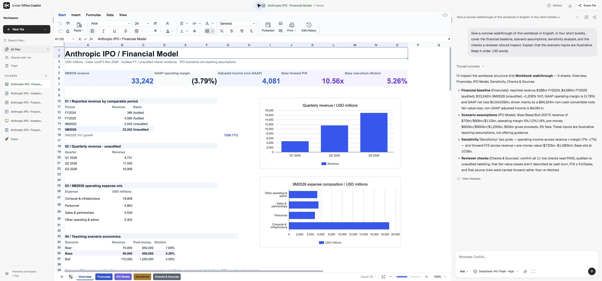
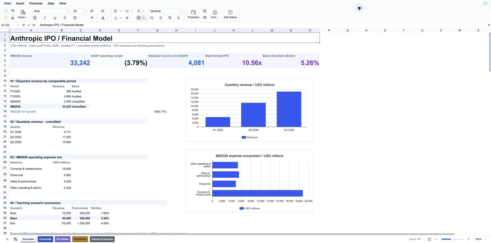
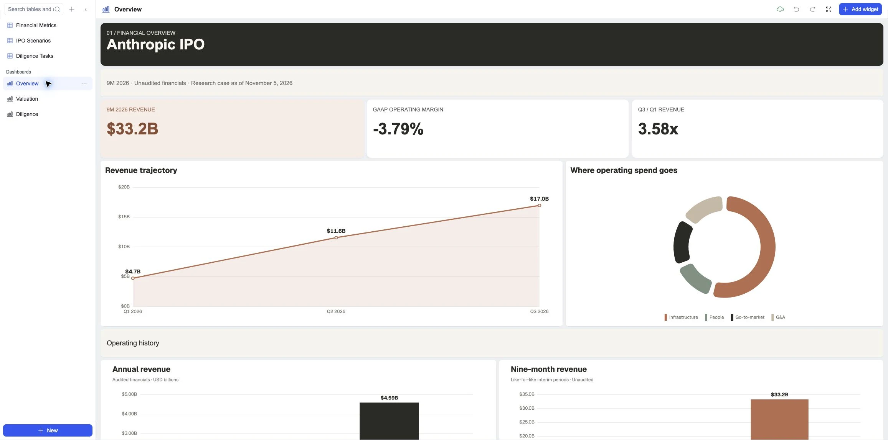
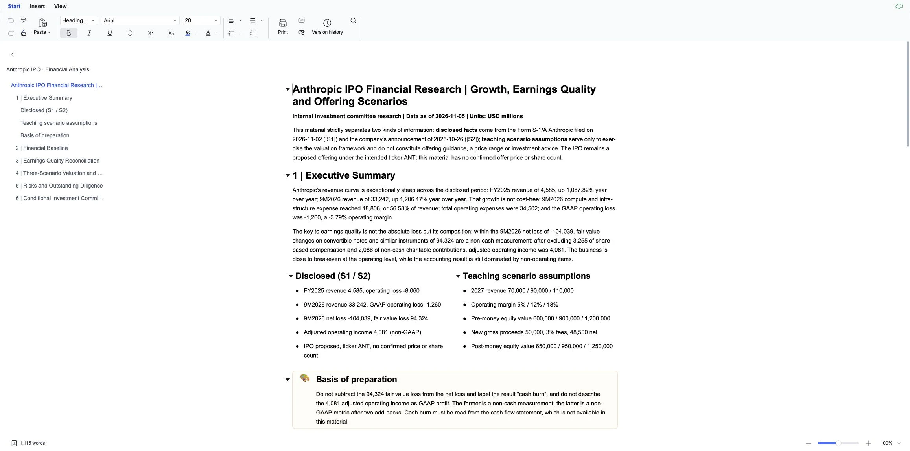
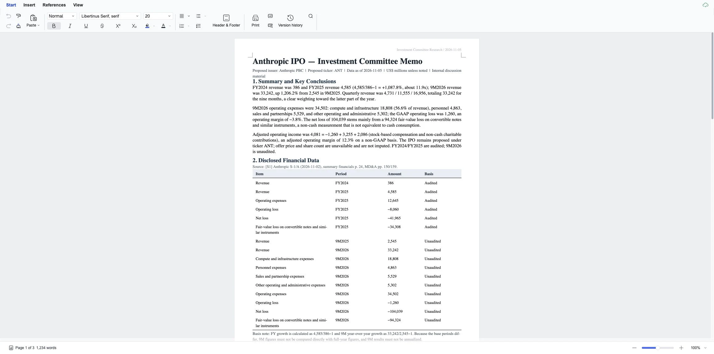
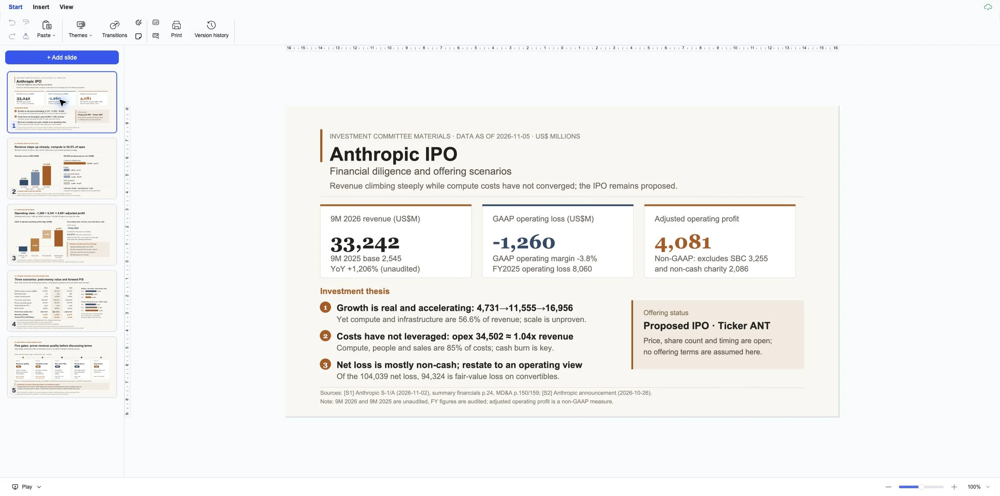
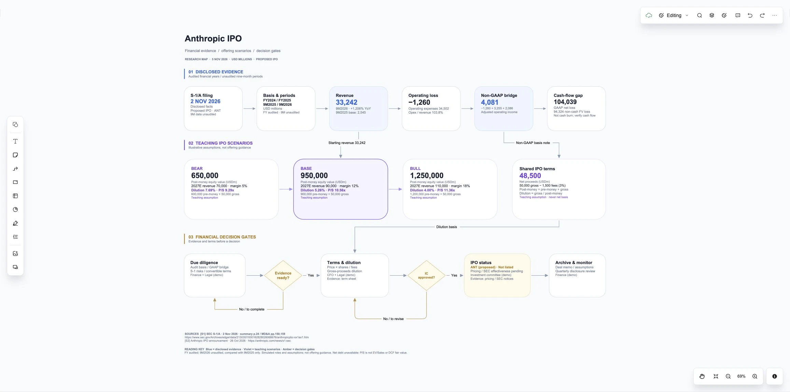
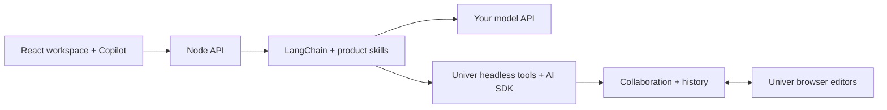

<div align="center">


# Univer Office Copilot

### Build your own Office copilot.

Chat with spreadsheets, docs, slides, relational tables, and canvases — in one collaborative web app.

**Univer Office SDK · LangChain · React · TypeScript · Bring your own model**

[Quick start](#quick-start) · [What you can build](#what-you-can-build) · [Explore the examples](#included-examples) · [Architecture](docs/architecture.md) · [Univer Docs](https://docs.univer.ai/)

[](https://github.com/dream-num/univer-office-copilot/actions/workflows/checks.yml)
[](LICENSE)
[](package.json)
[](tsconfig.json)

</div>

[](docs/images/copilot-overview.webp)

**A runnable reference app for developers building Office agents.** Start with a workspace, five real editor surfaces, a conversation assistant, and six editable examples. Connect your model, then adapt the tools, skills, and interface to your product.

Copilot reads the current file, runs backend editing tools, and checks the result. Confirmed edits appear through the same collaboration channel used by people. **Ask** explains; **Edit** changes the file directly. Native history lets users inspect changes and restore earlier versions.

## What you can build

| Build an app for…                    | Start with           | A first request to try                                                                           |
| ------------------------------------ | -------------------- | ------------------------------------------------------------------------------------------------ |
| **Financial modeling & FP&A**        | Sheets               | “Build a monthly budget with formulas, variance analysis, and a budget-versus-actual chart.”     |
| **Research & report writing**        | Modern or Paged Docs | “Draft a research brief with an executive summary, source notes, and a financial table.”         |
| **Investor & project presentations** | Slides               | “Create five editable slides covering the financial baseline, scenarios, risks, and next steps.” |
| **Operations & diligence tracking**  | Base                 | “Set up owners, priorities, deadlines, linked records, and a progress dashboard.”                |
| **Workflow & decision mapping**      | Board                | “Map the decision gates, evidence, responsible teams, and feedback loops.”                       |

Create or open the target file, then work in it through conversation. Attach workspace files or local research as context. Other attached Office files are read-only references; edits target the current file.

<a id="run-locally"></a>

## Quick start

Requires **Node.js 24+** and **pnpm 10.33.4**.

```sh
git clone https://github.com/dream-num/univer-office-copilot.git
cd univer-office-copilot
pnpm install --frozen-lockfile
pnpm dev
```

Open **http://127.0.0.1:5173**. Your local demo opens a financial workbook with **six private, editable example files** ready to explore. No AI key, Docker, or external database is needed to browse them.

To use Copilot, open the model menu in chat, choose **Add model** or **Manage models**, and enter your provider, model ID, and key. Choose **Ask** for a walkthrough or **Edit** to make changes. AI layout and rendered checks also need a local [Chrome, Chromium, or Edge installation](docs/local-development.md#render-browser).

> The application source is Apache-2.0. Embedded Univer Pro features have separate licensing terms; an unlicensed SDK retains its trial restrictions and watermarks. Screenshots below were captured with a configured SDK runtime license. See [local setup and licensing](docs/local-development.md#univer-licensing).

## Included examples

**Five Office surfaces. Two document modes. Six starting points.**

These are real screenshots of the bundled native files. Every case is editable after startup; click a preview to inspect the full image, or follow its snapshot link.

<table>
<tr>
<td width="50%" valign="top">
<a href="docs/images/showcase/financial-model.webp"></a>
<br /><strong>Financial model · Sheets</strong><br />Financial statements, IPO scenarios, sensitivity grids, and 11 live checks.<br /><a href="examples/financial-model.univer.json">Explore snapshot →</a>
</td>
<td width="50%" valign="top">
<a href="docs/images/showcase/base-dashboard.webp"></a>
<br /><strong>Diligence & dashboards · Base</strong><br />37 records with scenario links, three dashboards, and 15 native charts.<br /><a href="examples/financial-due-diligence.univer.json">Explore snapshot →</a>
</td>
</tr>
<tr>
<td width="50%" valign="top">
<a href="docs/images/showcase/modern-document.webp"></a>
<br /><strong>Financial research · Modern Docs</strong><br />Markdown-authored content, native tables, callouts, and a navigable outline.<br /><a href="examples/financial-analysis.univer.json">Explore snapshot →</a>
</td>
<td width="50%" valign="top">
<a href="docs/images/showcase/paged-document.webp"></a>
<br /><strong>Investment memo · Paged Docs</strong><br />Typst-authored pages, structured financial tables, and running headers.<br /><a href="examples/investment-committee-memo.univer.json">Explore snapshot →</a>
</td>
</tr>
<tr>
<td width="50%" valign="top">
<a href="docs/images/showcase/presentation.webp"></a>
<br /><strong>Investor presentation · Slides</strong><br />Five slides with editable SVG-authored elements, charts, and decision gates.<br /><a href="examples/investor-presentation.univer.json">Explore snapshot →</a>
</td>
<td width="50%" valign="top">
<a href="docs/images/showcase/decision-map.webp"></a>
<br /><strong>Financial decision map · Board</strong><br />Evidence cards, scenario comparisons, bound connectors, and feedback loops.<br /><a href="examples/financial-decision-map.univer.json">Explore snapshot →</a>
</td>
</tr>
</table>

**Make the next example yours.** Start from these files or create a blank Sheet, Doc, Slide, Base, or Board. [Extend the app →](docs/extending.md) · [How the snapshots work →](examples/README.md)

New demo accounts receive independent copies with fresh identities and revision-one history. Existing files are never reset. The snapshots include file contents and applicable document authoring maps; **no conversations, accounts, attachments, share links, model profiles, or credentials are bundled**. The hero shows a separate demonstration conversation. Set `DEMO_EXAMPLES=false` to start with a blank spreadsheet.

The financial cases use a November 5, 2026 cutoff and distinguish reported data from illustrative scenario inputs. They are examples, not a live financial data feed.

## What is already connected

| Capability                 | Included in the app                                                                                                                |
| -------------------------- | ---------------------------------------------------------------------------------------------------------------------------------- |
| **Office editing**         | Native editors for Sheets, Modern/Paged Docs, Slides, Base, and Board.                                                             |
| **Agent tools & skills**   | Version-matched API lookup, bounded backend scripts, product authoring skills, assertions, rendered previews, and repair feedback. |
| **Live collaboration**     | Agent edits and human edits use the same shared document state.                                                                    |
| **Changes & recovery**     | Native file history, per-turn change inspection, and owner-controlled whole-file restore.                                          |
| **Conversation workspace** | Multiple chats per file, switching, search, attachment context, and separate file/conversation sharing.                            |
| **File transfer**          | Native JSON for every surface, plus product-specific Office import/export.                                                         |
| **Bring your own model**   | Six provider adapters, streamed responses, and provider-supplied reasoning where available.                                        |

### An architecture you can build on



The model works through backend tools against the current file. A collaboration acknowledgement confirms each edit, and the browser receives the update through the SDK. Modern Docs use Markdown; Paged Docs use Typst; Slides use SVG compiled into editable elements. [Explore the architecture →](docs/architecture.md)

## Bring your own model

**OpenAI · Anthropic · Google Gemini · DeepSeek · OpenRouter · Custom OpenAI-compatible HTTPS endpoints**

Model IDs are editable. Tool calling, vision, and reasoning depend on the selected model and route. Keys entered in chat stay in page memory and clear on reload; non-secret profiles are saved locally on the server. Optional server-side DeepSeek setup uses a Git-ignored `.env.local` in loopback demo mode.

[Model setup, key handling, and local configuration →](docs/local-development.md#optional-local-deepseek-configuration)

## Developer guides

| Start here                                       | What it covers                                                                         |
| ------------------------------------------------ | -------------------------------------------------------------------------------------- |
| [Local development](docs/local-development.md)   | Setup, providers, attachments, file transfer, licensing, tests, and production builds. |
| [Architecture](docs/architecture.md)             | Module boundaries, storage ownership, collaboration, and the edit lifecycle.           |
| [AI authoring](docs/ai-authoring.md)             | Product skills, scripts, Markdown, Typst, SVG, verification, and known limits.         |
| [Extend the app](docs/extending.md)              | Add a tool, product adapter, or provider without coupling the UI to vendor internals.  |
| [Office feature matrix](docs/office-features.md) | Product plugins, Ribbon layouts, and service requirements.                             |
| [Development status](docs/status.md)             | Validated behavior and remaining limitations.                                          |

### Explore the Univer ecosystem

| Project                                                           | Use it for                                                                                                         |
| ----------------------------------------------------------------- | ------------------------------------------------------------------------------------------------------------------ |
| [Univer](https://github.com/dream-num/univer)                     | Office engines, editor APIs, and the SDK foundation.                                                               |
| [Univer Workspace](https://github.com/dream-num/univer-workspace) | A broader workspace with Spaces, CLI access, and Worktree review workflows.                                        |
| **Univer Office Copilot**                                         | A focused reference app for conversation, direct editing, collaboration, and recovery across five Office surfaces. |

## Contributing & licensing

Issues, example improvements, and focused contributions are welcome. Read [AGENTS.md](AGENTS.md) and use the [PR template](.github/pull_request_template.md). Keep local environment files, databases, conversations, generated bundles, and submodules out of commits.

Application code: **[Apache-2.0](LICENSE)**. Univer SDK packages retain their own licenses; this application does not grant a Univer Pro license. [SDK integration notes →](docs/sdk-notes.md)
