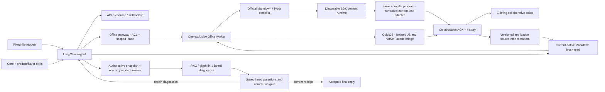

# AI authoring architecture

LangChain owns provider orchestration and streaming. Univer AI SDK owns native API reference, structured inspection, Markdown/Typst/SVG compilation, resources, screenshots and layout diagnostics. Application-owned skills explain the content and verification workflow.

## Content paths

| Product / flavor | Generation                                                                                        | Verification                                                                                |
| ---------------- | ------------------------------------------------------------------------------------------------- | ------------------------------------------------------------------------------------------- |
| Modern Doc       | `@univer-cli/doc-markdown-facade`: CommonMark/GFM and Univer directives → native editable content | Current-native block export, source-map identity/boundary checks, structural reads and PNGs |
| Traditional Doc  | `@univer-cli/doc-typst-facade`: ordered Typst source bundle → native editable physical pages      | Native paper/section/header/footer/table reads, compiler fidelity diagnostics and page PNGs |
| Slide            | Official SVG compiler with browser-measured text → editable elements                              | Per-page glyph lint and PNGs                                                                |
| Sheet            | Typed cells, formulas, formatting and native builders                                             | Calculation barriers, native/formula readback and range PNGs                                |
| Base             | Native fields, records, relations and view configuration                                          | Typed record/config inspection and workbench previews                                       |
| Board            | Semantic shapes and element-bound connectors                                                      | Specialized diagram skills, rendered routing/layout evidence and PNGs                       |

Modern and Traditional are flavors of the same Doc product, not two new file types. **New file** offers both, and the server creates the appropriate native snapshot. Existing Docs default to Modern metadata. The current file's flavor controls the loaded skill and compiler; generation cannot implicitly switch flavors. Local edits in either flavor continue through public native Facades.

## Boundaries

SDK integration stays inside `server/src/office`. Agent tools and skills stay inside `modules/copilot`. Shared contracts contain JSON DTOs, including bounded script source strings; vendor/runtime objects never cross that boundary. SVG compilation retains the gateway's browser text-measurement path.

## Applying to the current shared document

The SDK's Markdown and Typst programs create a Doc. This sample already has a shared file and must preserve its Unit identity, permissions, links and history. The worker first compiles and validates the program in a disposable standard SDK runtime. This happens before application-specific global Facade extensions are registered, so the temporary runtime does not inherit collaboration-only service requirements.

For an explicit complete rewrite, the adapter removes old resource-backed objects and resets content using the SDK empty-document snapshot and public `RichTextEditingMutation`/JSONX APIs. It never constructs paragraph markers, table storage or drawing data. A flush confirms that reset before subsequent SDK writes can mutate values referenced by the reset operation. SDK 1.3.1 header/footer creation also retains mutable JSONX values; the adapter checkpoints the finished native segments to prevent duplicate text on collaboration replay. The controlled Facade maps the compiler's single expected creation to the already loaded current Doc; creation of another Unit is rejected. The same validated program then creates native objects through their normal Facades. Preflight does not make the distributed edit atomic: if a live operation fails after some writes, confirmed intermediate revisions remain available in history.

A Markdown selected-block update skips the reset and executes the official update program against the current native document. Typst compilation is a full rewrite; use native Facades for local Traditional edits. Errors block compilation/apply; warnings describe fidelity limits requiring review. Only SDK-generated programs reach the trusted Node execution helper. Model-authored scripts use the separate QuickJS VM and fixed-Unit native bridge.

## Markdown skills and current-native editing

The Modern guide and syntax reference are adapted from [Workspace PR #170](https://github.com/dream-num/univer-workspace/pull/170), pinned to `f855c66f765c6bf16327669cf60afc12f5e8b59d`. The registry now provides `@univer-cli/doc-markdown-facade@1.3.1`. The previous application `marked` converter is removed. `registerDocMarkdownRuntime` registers the SDK's native range, chart-header and list helpers through its public extension entry.

The compiler preserves SDK default typography and native callout styling. Supported constructs include semantic text, links/bookmarks, lists/tasks, tables, images, native quotes/code/callouts, ColumnGroups, charts and shapes. There is no post-conversion cosmetic styling pass. Native images retain their SDK limitations, including unsupported alternative-text persistence.

Give editable regions explicit root IDs. The application saves the **execution** map, containing actual native identities, rather than relying on the static compilation map. Before each partial change, `doc.markdown.read` exports the selected **current native** blocks and refreshes the map; it does not read the original Markdown. Keep exported root IDs and asset paths, then call `doc.markdown` with the same `blockIds`. Other blocks and native identities remain untouched. SDK 1.3.1 can regenerate split paragraph IDs during remote TextX replay; the adapter checkpoints newly generated identities through the public OT mutation before retaining the execution map. Native writes and mapping reads/checkpoints share the serialized worker queue. Original source returned by `office_source` is provenance and can be a fragment.

Maps and inline resources live under `.data/document-maps`, including revision checkpoints for file-history restoration. They are private application metadata protected by current file ACL checks. Back them up with the application data. They do not replace native content. Invalid or unavailable mappings reject Markdown export/update; native Facade editing remains available. Read revisions are metadata, not a caller-supplied commit protocol.

SDK mapping checks validate object identities and block boundaries. They do not detect every intervening text/style change that retains the same identities. Export immediately before updating and re-read/replan after a conflict. Custom fonts/spacing, merged/richly styled tables, mixed text/image paragraphs and custom chart/shape styles can exceed the export format and produce blocking diagnostics. Do not flatten these or regenerate unrelated content to disguise a failure.

## Typst and assets

`doc.typst` supplies ordered page strings, an optional shared prelude and local assets. The worker creates a private temporary bundle with a fixed manifest/target, compiles through the SDK's official native binding, and removes temporary files after use. The native binding has its own wrapper-owned version; no system Typst or unrelated converter is installed as a fallback. This produces native Doc content, not an embedded PDF or page bitmap. In 1.3.1 the compiler intentionally projects source pages into one continuous editable flow: it can reuse the first static header/footer and does not preserve source-page boundaries as fixed tokens. Native content remains paginated but can have a different physical page count; these fidelity warnings are returned unchanged. The known unsupported `#set list(...)` source directive is rejected before invoking the native compiler or touching the current file; the bundled guide uses native list defaults instead.

Both document paths accept bounded inline assets under safe `assets/` paths. Absolute/network paths, parent traversal, empty path segments and overwriting the generated Typst manifest/page sources are rejected. Images are at most 1 MiB each, with 20 assets/4 MiB total. The official Markdown resolver handles native chart/shape JSON. Current-native exports retain inline image bytes privately; model responses receive image metadata rather than the base64 payload. Reference-backed external images require an authenticated resource adapter and are rejected by this local sample.

## Visual and runtime boundaries

One lazy SDK browser serializes SVG text measurement, lint and preview capture, and closes with the application. The Render Page is built independently from the application UI. Preview URLs require current file permissions and retain dimensions in run events; PNG bytes are not stored in conversation messages. Chat Markdown loads only same-origin, permission-checked preview images automatically.

Only explicitly image-capable provider routes receive actual PNG inputs. Text-only routes receive structured diagnostics and preview metadata and must not claim pixel inspection. DeepSeek checks use this text-only path; screenshots are checked separately. Runs have bounded tool calls, elapsed time and public output; confirmed edits survive cancellation or limits.

The SDK render browser runs without Chromium's sandbox. A production deployment needs isolated, resource-limited rendering and network controls for native assets. The local sample remains restricted to loopback. SDK 1.3.1 Slide PNG capture also has a known edge-framing discrepancy near bottom annotations despite passing glyph lint, so native editor checks remain necessary.

Native callback-taking APIs, lossless conversion of arbitrary native Docs, cross-Unit embedded applications, licensed Office export and all providers' live image behavior remain separate validation work. Existing sharing, collaboration and history retain their current modules. No SDK UI/Design internals or sibling source packages are modified.

Primary references: [AI SDK catalog](https://docs.univer.ai/ai/packages), public Markdown/Typst package READMEs at 1.3.1, [Doc flavors](https://docs.univer.ai/guides/docs/features/core), and the attributed Workspace/CLI skills.

## CLI-equivalent scripts and required verification

The current product's complete adapted reference now loads automatically, together with core and product guides; Doc flavor selects Markdown or Typst, and Board loads its specification plus on-demand diagram topics. These are versioned files in the repository, not paths to a developer workstation or an external CLI installation. Source tool names are mapped to this application's tools and its direct-edit lifecycle. Worktrees, draft approval and merge are not introduced.

`office` accepts `script.read` and `script.write` with JavaScript `code`. Stable bindings follow `@univer-cli/content-execution@1.3.1`: `workbook`, `doc`, `presentation`, `base`, `board` and `univerAPI`/`api`. Use functions/loops/local array callbacks to compute and author; await asynchronous Facade operations. Native callbacks, imports, Node, shell, arbitrary network and private SDK runtime access are unavailable. Legacy narrow actions and JSON plans remain for compatibility. The headless worker applies every authorized mutation directly through the existing collaboration client and waits for ACK; the browser receives the same updates as another collaborator.

After any confirmed writes, `office_verify` runs a fresh read-only script with task-specific `assert(condition, message)` checks and captures actual rendered evidence. It runs glyph lint for Slides and reads rendered Board routing/layout diagnostics. Supply the affected Sheet range, explicit Doc/Slide pages (up to eight in a batch), or Board content/focus. Verification checks the collaboration head before and after, rejects concurrent changes, and does not mutate the file. Errors and failed assertions return tool diagnostics to the model for repair; caught failed assertions still fail. Intentional layout warnings need exact IDs and explicit reasons; layout errors cannot be suppressed. A model final response is accepted only with a receipt for the latest saved head. An unavailable renderer causes an honest verification failure; confirmed edits remain saved.

This validates the assertions and targets supplied by the agent. It does not mechanically prove that its coverage exhausts the request. Text-only providers do not inspect pixels. Native SDK allocations remain outside the guest memory budget. See the [architecture](architecture.md#backend-script-execution-and-completion-gate) for isolation, limits, streaming and ownership details.
