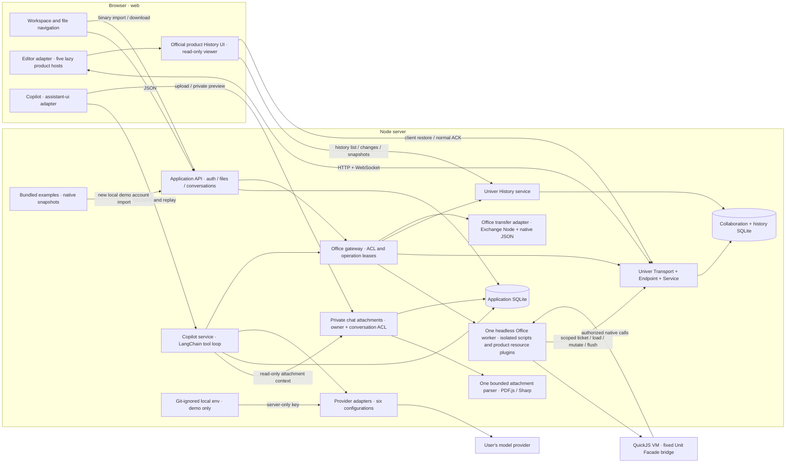
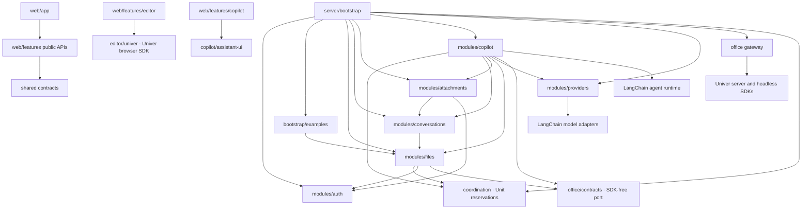

# Architecture

The application is a **modular monolith** with a React client and one Node server. SQLite keeps local startup small. The server embeds Univer Collaboration SDK; there is no separate Univer Workspace service and no dependency on the Univer Workspace application.

## Runtime



Model API keys reach the provider adapter only. Page keys remain ephemeral; local demo mode may instead resolve DeepSeek credentials from the Git-ignored server environment. `/provider-profiles` returns only a `serverKeyAvailable` flag. A missing browser key is resolved only for the official DeepSeek adapter in loopback demo mode, and a supplied page key takes priority. The Files, conversation and sharing APIs never receive the environment credential. Worker and rendering environment copies omit `DEEPSEEK_API_KEY`. The worker receives a short-lived, file-scoped operation token, never a model key. The key is not written to the application database, events, conversation snapshots, or logs.

The [AI authoring adapter](ai-authoring.md) composes core/product skills, public API reference, visual resources, structured inspection, isolated native Facade scripts, official Modern Markdown and Traditional Typst authoring, and browser-measured SVG compilation. A single lazy render browser supplies previews and layout evidence. These capabilities retain the same fixed-file authorization, worker and collaboration commit path shown above; they share a fixed-Unit script bridge rather than adding another Workspace service. Model-authored JavaScript executes only in QuickJS; the trusted compiler helper remains a separate execution path.

## Source dependencies

Arrows mean static source imports. Composition happens only in `bootstrap/app.ts`. Services receive public interfaces rather than reaching into another module's tables or repositories.



`conversations` receives an injected read-only run-summary function during composition. It uses this to exclude unfinished turns and publish modification summaries. It has no static import of Copilot and does not query Copilot-owned tables. The callback is invoked after composition, not while constructing modules.

`scripts/check-architecture.mjs` checks package isolation, cross-feature public APIs, vendor import placement, module import cycles, and ownership of tables referenced by SQL. Tests are allowed to import fixture models; production browser code cannot import server or Node modules. Shared contracts contain JSON DTOs and Zod schemas only.

## One AI edit

```mermaid
sequenceDiagram
  participant User
  participant Web as Browser and editor
  participant Agent as Copilot service
  participant Model as Provider adapter / model
  participant Office as Office gateway / worker
  participant SDK as Collaboration service
  participant DB as SQLite
  User->>Web: Send in Edit mode
  Web->>SDK: Flush pending manual edits
  Web->>Agent: Fixed file, conversation, selection, model profile, ephemeral key
  Agent->>Agent: Check owner and file permissions; reserve this Unit
  Agent->>Model: Messages and typed tool schema
  Model-->>Agent: Tool call
  Agent->>DB: Persist prepared operation
  Agent->>Office: Execute fixed-target action with operation token
  Office->>SDK: Load shared Unit and apply Facade action
  Office->>SDK: Flush and wait for ACK
  SDK->>DB: Commit a new revision
  SDK-->>Web: Normal collaboration broadcast
  SDK-->>Agent: changesetCommitted · exact revision and operation association
  Agent->>DB: Persist per-turn modification
  Office->>Office: Bounded read after ACK
  Office-->>Agent: Tool result and checked location
  Agent-->>Web: Modification and stream events
  Agent->>Model: Actual tool result
  Agent->>Office: Fresh readonly script assertions + render / lint
  Office-->>Agent: Saved-head receipt or repair diagnostics
  Agent->>Model: Repair if needed; verify again
  Model-->>Agent: Final response candidate
  Agent->>Agent: Require current receipt before completion
  Agent->>DB: Persist completed message
  Agent-->>Web: Completion
```

The browser never reapplies AI mutations from chat events. A text response or successful tool invocation alone is not proof of a committed edit. One operation may produce multiple confirmed SDK revisions; every revision is retained.

Browser product hosts register complete authoring profiles through public presets/plugins. `office/products/plugins.ts` registers their model/resource counterparts in the headless worker, so Copilot can replay files containing manually authored charts, tables, comments, and other extension resources. UI plugins stay in the browser. See the [Office feature matrix](office-features.md) for product-specific composition and service boundaries.

## Native file history

Each lazy product adapter registers its public history model and UI plugins after the editor profile, before loading its Unit. `editor/univer/history.ts` supplies the shared history service configuration, locales and an application-owned viewer mount point. The application opens the registered product operation; Univer creates and owns a separate read-only viewer, version selection, differences, confirmation and restoration. The application neither imports private SDK services nor implements a parallel version dialog.

SDK 1.3.1 Docs re-emits the last document state to a new collaboration entity when restoring by reloading a Unit inside the same host. The Doc adapter uses the public `viewerPlugins` and `IUniverEditHistoryUIConfig.onRestore` extension points: keep native preview and confirmation, execute `HistoryRestoreService` on the host client, await its collaboration ACK, and recreate only the Doc editor. The conversation remains mounted. No private SDK service or UI/Design override is used. Other products retain native viewer restoration and reload.

A mount observer keeps the covered editor inert and pauses new Copilot sends while history is visible. Closing the viewer preserves the conversation and composer draft. At every screen size the Copilot container is temporarily hidden without unmounting it or changing its expanded/collapsed preference. Closing history restores its previous visibility, width and draft. The per-turn dialog lists exact committed **revisions** and offers one **Open file history** action. SDK history can group several revisions into one displayed version; this entry does not promise to auto-select an exact revision or selectively undo one turn.

The History service receives a public user-provider adapter during composition so native rows display collaborator names. AI association uses the SDK's reserved `additionalFields`; restores are identified by the public revert mutation rather than marked as AI edits. All native history reads retain the server history ACL, and restore retains the Owner-only commit check. Markdown/Typst source maps follow the confirmed restored revision; conversations and turn records remain application-owned.

## Ownership

| Module        | Owns                                                                      | Public responsibility                                           |
| ------------- | ------------------------------------------------------------------------- | --------------------------------------------------------------- |
| auth          | users, sessions                                                           | stable actors, credentials, session cookies, public user lookup |
| files         | files, folders, permissions, file links; create/restore operation records | file lifecycle, ACL, sharing, recovery coordination             |
| conversations | conversations, messages, conversation links                               | private conversation history and immutable public snapshots     |
| attachments   | attachments                                                               | private upload validation, parsing, content and preview ACL     |
| providers     | profiles                                                                  | non-secret configuration and ephemeral model instances          |
| copilot       | runs, run events, run changes; Office operation records                   | agent loop, cancellation, event replay, commit association      |
| office        | SDK databases and worker                                                  | SDK transport, ACL hooks, typed actions, revisions, history     |
| coordination  | in-memory Unit reservations                                               | serialize AI runs and whole-file restores in this process       |

`operations` is a small durable operation journal with separate `kind` values. File creation can be recovered after a crash. AI execution interrupted by a restart is marked interrupted; confirmed file revisions remain authoritative. An uncertain write is never automatically rerun.

## Consistency and permission rules

- File permissions are checked at API access, SDK HTTP reads, realtime JOIN, tool execution, and changeset commit. Unknown identities fail closed.
- Only the current fixed file can be written. Attached files are read-only and checked separately. Ask mode rejects every write.
- Only one AI run per Unit is active in this process. Human collaborators continue to edit normally through the SDK's collaboration mechanism.
- Cancellation stops subsequent tool work and invalidates the current lease. Already committed changes stay saved.
- Whole-file restore stops an active run, requires Owner access, and checks the expected head revision again during commit. Restoration adds a revision and never truncates history. Native browser restores reserve the Unit through an injected coordinator callback before entering the SDK commit lock. API restores use the existing coordinated worker path. The SDK commit event restores document mapping checkpoints for both paths.
- File links and conversation links use opaque tokens stored as hashes. Public conversation content is snapshotted at publication; subsequent messages are private until separately published.
- `office/viewer-reads.ts` serves Viewers a materialized current snapshot. It excludes historical catch-up changesets and restricts Sheet block reads to that snapshot. A bounded cache records the first visible revision; reconnecting viewers reload the current snapshot. History access is checked independently of the editor's UI permissions.
- Worker sessions are short-lived and explicitly evicted after each operation. Whole-file restore executes the public `RevertRevisionMutation` through the joined client and waits for its normal collaboration ACK. The server does not submit a changeset on behalf of an idle client. Worker error listeners remain attached through termination, including after a result has been confirmed.
- Conversation publication requires management access to every referenced file. Opening a conversation link grants no Office file permission.

## Scope

This is a single-process example. Multiple application instances require distributed Unit coordination, persistent job recovery, pub/sub, shared databases, and operational controls. These are intentionally outside the local sample's startup path. See [status](status.md) for remaining work and verification limits.

## Per-turn comparisons

The existing history preview endpoint returns materialized native UnitData for an authorized exact revision. The Office gateway reconstructs that state with the public snapshot materializer and product converters; it never returns an old snapshot with unapplied changesets. The browser editor adapter prepares a comparison through the public Univer Facade and translates it into SDK-free, paged presentation data. Copilot imports only the editor feature's public contracts. No vendor comparison types enter shared wire contracts or chat UI modules.

Per-edit restoration targets the previous revision; whole-turn restoration targets the revision before the first confirmed edit. Both replace the complete file, including any subsequent/interleaved collaborator edits, and use the existing owner-only, expected-head-checked, journaled restore operation. The confirmation states this consequence. Restoration adds a version, preserves earlier versions, and remounts only the editor after ACK. It does not delete conversation messages or imply that arbitrary later edits can be selectively retained.

## File transfer

`workspace/transfer.tsx` owns the import/export dialogs. The Files API authenticates uploads before reading the binary body, bounds uploads at 20 MiB and validates the target. The Files service asks the SDK-free Office port to convert/validate before creating metadata. The create journal stores imported UnitData and optional Doc authoring state alongside the new file identity so recovery cannot silently replace an interrupted import with a blank file. Known validation failures close the journal operation; uncertain storage failures remain recoverable.

`office/transfer.ts` is the only file-conversion adapter. It uses public Exchange Node APIs for Sheet/Doc/Slide/Base Office formats and a versioned `.univer.json` envelope for all five native products. Native data is replayed under a fresh Unit ID, Owner and revision; document maps are checkpointed at revision 1. Imported ACL, conversations and file history are never accepted. Export checks read access, flushes the browser editor first, and downloads the materialized current snapshot. Native backup reads the model's UnitData rather than serializing the protocol snapshot/Sheet blocks. Board currently uses native JSON because Exchange Node 1.3.1 has no Board conversion type. SDK quota or license failures stay inline in the export dialog with JSON backup available.

## Private chat resources

Schema version 5 adds conversation-owned `attachments` and message attachment metadata. The Attachments module alone reads/writes resource rows; Conversations owns the message JSON column. The upload API authenticates before reading a bounded 20 MiB binary body, checks conversation/main-file access again after parsing, and never accepts client-authored attachment metadata. Resource reads, originals and normalized previews require the owning actor and current conversation access. Deleting the conversation cascades resources; removing a draft card only detaches it. Unsent successful uploads persist until their conversation is deleted. Public conversation snapshots exclude resource IDs/metadata/downloads; public reply text can still contain extracted information. File sharing does not grant access to private chat resources.

One on-demand parser worker handles PDF.js extraction or Sharp decoding, separate from the single Office worker and without model credentials. At most three jobs are admitted and one parser is active; each has a 20-second deadline and 192 MiB JavaScript heap limit. Image pixels and preview bytes, PDF pages and text characters have separate bounds. Worker limits protect HTTP responsiveness but are not an OS/native-memory sandbox; externally hosted untrusted upload processing needs process/container isolation and storage quotas. Originals are forced downloads with `nosniff`; previews are normalized WebP or escaped text, not executable uploaded documents. PDF support reads existing text layers and does not perform OCR.

Copilot validates attachment IDs against the current conversation before recording a run. Workspace references still use Files/Office read-only APIs; raw resources use a bounded, paginated `read_attachment` tool. Metadata and file text are untrusted model data. Current images are sent as normalized image blocks only for explicitly image-enabled profiles; previous attachments remain readable from recent message context. No attachment can change the fixed Office write target. The frontend queues uploads sequentially and retains draft state per mounted chat; accepted user messages persist authoritative attachment metadata for cards after reload. Uploaded Office files enter through the existing Files import path and remain independently managed workspace files.

## Local model configuration

The providers module reads `DEEPSEEK_API_KEY`, `DEEPSEEK_MODEL`, `DEEPSEEK_REASONING_EFFORT` and the legacy `DEEPSEEK_THINKING` flag once at composition only when local demo mode is enabled. An explicit effort setting takes priority over the legacy flag. Its non-secret profile is seeded per authenticated user only if no DeepSeek profile exists. The input schema deliberately excludes the server-availability field, so a client cannot persist or spoof credential availability. Both connection tests and Copilot runs use the same credential resolver. Custom/OpenRouter endpoints cannot borrow the DeepSeek key. Normal deployments (`DEMO_MODE=false`) retain page-supplied keys only. The `.env.example` is public documentation; real `.env.local` contents stay ignored and require a service restart after changes.

## File icon metadata

The Files module owns optional `emoji` metadata in application SQLite (schema version 4), separate from authoritative Office content and native revision history. The shared schema accepts one complete Unicode RGI emoji sequence or `null` for the product default. The existing owner-only PATCH endpoint updates it; file lists and read-only file shares expose the same saved icon. Existing files migrate with `NULL`, preserving their native Unit identity, document flavor and content. Workspace refresh synchronizes current-file metadata without remounting its editor or chat. The lazy emoji picker and shared Popover remain browser UI dependencies; no SDK plugin or Office mutation is involved.

## Model discovery and reasoning

`providers/models.ts` translates DeepSeek's authenticated, official model-list response into SDK-free `ModelOption` DTOs. Only the fixed HTTPS provider endpoint is called, redirects are rejected, requests time out, and errors never echo upstream credential-bearing data. The browser receives names, IDs and capability metadata, never server keys. The composer owns cancellable discovery state and saves configuration changes through the existing owner-scoped profile API; it does not move credentials into profiles or storage.

DeepSeek profiles optionally store `reasoningEffort` (`off`, `low`, `high`, `max`). Missing fields retain the legacy thinking flag (true → High, false → Off); explicit effort wins. The adapter maps Off to `thinking.type=disabled` and all other levels to `enabled` plus the actual `reasoning_effort`. The shared profile validator rejects applying DeepSeek effort values to other providers. Existing Anthropic/Google/OpenAI controls stay in their adapters. Application output-token and run-time limits still apply regardless of effort.

References: [DeepSeek model metadata](https://api-docs.deepseek.com/api/list-models/), [thinking controls](https://api-docs.deepseek.com/guides/thinking_mode/), and the reference [Harness selector](https://github.com/deepseek-ai/deepseek-harness/tree/master/packages/client/ui-model-selection).

## Backend script execution and completion gate

`office/authoring/script.ts` uses the official CLI content-execution prelude, binding only the current `workbook`, `doc`, `presentation`, `base` or `board` and `univerAPI`/`api`. A fresh QuickJS VM receives opaque native handles through a JSON bridge, never Node functions or live SDK objects. JavaScript loops, local functions, array operations and awaited mutations work in the VM. Public synchronous getters stay synchronous; async Facade results become guest Promises. The host drains those completions before advancing the guest queue. Model source never enters the trusted compiler's Node `AsyncFunction` helper.

The VM has a 15-second deadline, 64 MiB guest memory limit, 512 KiB stack, 2,000 native calls and bounded source/bridge/results/logs. The worker retains its independent 45-second lifetime and scoped operation lease. There is no module loader, filesystem, shell, fetch or timers. The bridge rejects private/runtime/service/permission access, another Unit, native callback arguments and mutation methods in read/verify mode. The collaboration lease independently rejects read-mode commits. Native SDK operations/rendering run outside the VM memory budget; this is a local application example, not OS-level multi-tenant process isolation.

`modules/copilot/verification.ts` serializes tools per run and issues a receipt only after a fresh read-only script reads native content, calls task-specific `assert`, renders the supplied changed targets and checks Slide/Board diagnostics. Layout errors block completion; intentional warnings require exact finding IDs and recorded reasons. A concurrent human edit invalidates the receipt. The LangChain after-model middleware rejects a final response without a current receipt after confirmed writes, allowing bounded repair/verification retries. Edit-mode final text is held until acceptance; actual provider reasoning and tool progress continue to stream. Failed, cancelled and partially committed operations remain in normal file history. Verified badges are assigned after this gate, rather than after a structural read alone.

Evidence is target-scoped. The agent must select all affected ranges/pages/objects and make meaningful assertions; the gate cannot establish that arbitrary model-authored assertions fully express user intent. Text-only model routes receive diagnostics and preview metadata rather than pixels. Successful verification proves the asserted saved state and rendered targets, not every possible interaction or API in a product.

## Conversation selection and continuity

A file has many conversations; each conversation has one fixed main file and one private owner. `modules/conversations` owns title/message search, cursor pagination, mode preferences, management and separately revocable conversation links. Message search uses an indexed conversation relation and filters both the file and owner before returning results. A bounded matching-text preview is an optional JSON DTO field. Metadata-only title/mode updates do not create Office revisions.

`copilot/conversation-picker.tsx` owns the list, search, date groups, pagination, action menus and management dialogs. `Copilot` owns selection, file context and task orchestration. `assistant-ui/thread.tsx` binds each selected conversation's draft through the public composer runtime; the chat store remains independent of the UI library. Selection stores only a conversation ID in tab session storage and revalidates it through owner/file checks when restoring it. Draft text and reference/selection context stay in memory. No credentials are included.

Switching preserves the original run's event stream. Rehydrating the same active run keeps its cursor and already received deltas. A separate running-conversation selector drives the file-busy notice, so a newly opened chat cannot show the old chat's Stop button or start another operation against that file. All chats still edit the one authoritative collaborative Unit. Renaming, creating, selecting and deleting a conversation never restores or copies Office content.

## Default example snapshots

The Office import adapter retargets same-Unit `unitId`/`unitID` references in native objects and serialized plugin resources when assigning the new Unit identity. This preserves chart ranges and drawing ownership without changing literal document text or references to other Units. Excessively nested payloads are rejected with a client error, so the Files create journal marks them failed rather than retrying them on every startup.

`bootstrap/examples.ts` composes a fixed, local catalog through the Files module's public import/update API. The normal process entry enables it by default; embedded applications and tests opt in with `demoExamples: true`. The composition root injects the initializer into Auth, which awaits it only when creating a new local demo account and before issuing its session cookie. Normal registration and login never run it.

The seven portable snapshots in `examples/` use the same validated native import path as user-uploaded files. Each copy gets a fresh file/Unit identity and owner, starts at revision one, and saves any Modern Doc authoring map with the new Unit. No account, permission grant, share link, conversation, model profile, credential or historical changeset is copied. Example creation uses the existing journaled Files workflow, so interrupted creates use the same startup recovery. Existing workspaces are not overwritten, and browsing or refreshing never seeds files. `DEMO_EXAMPLES=false` disables this local onboarding behavior. The CI browser fixtures disable examples explicitly so their empty-workspace scenarios remain deterministic.
